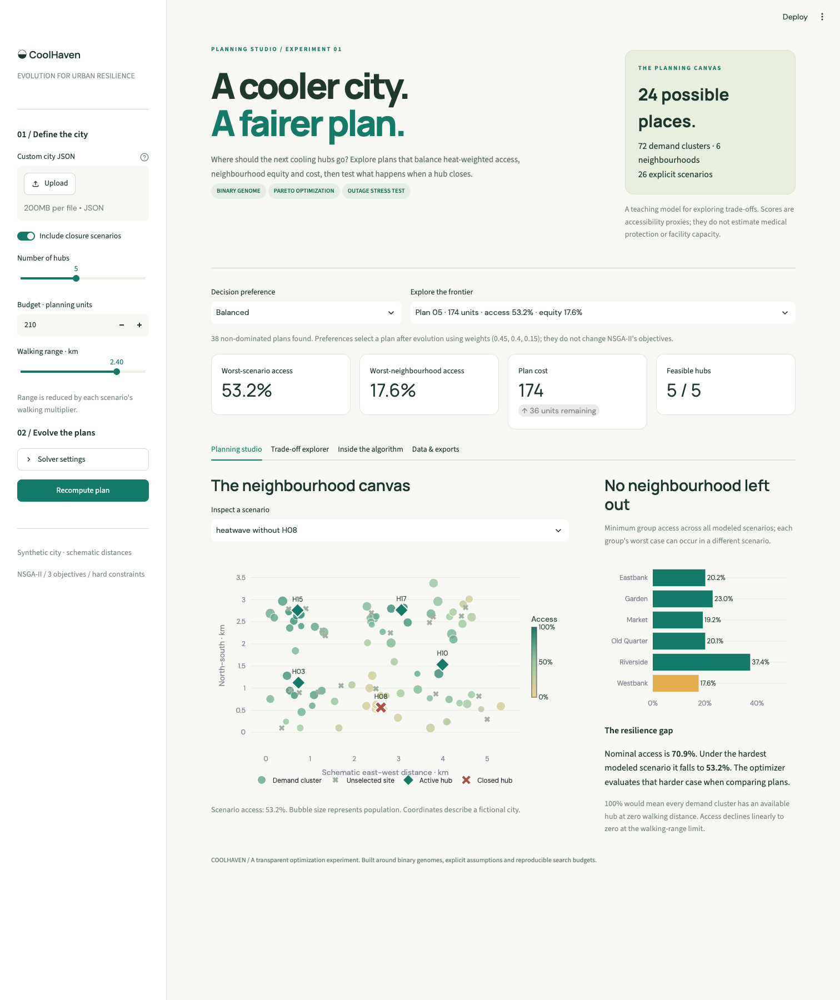
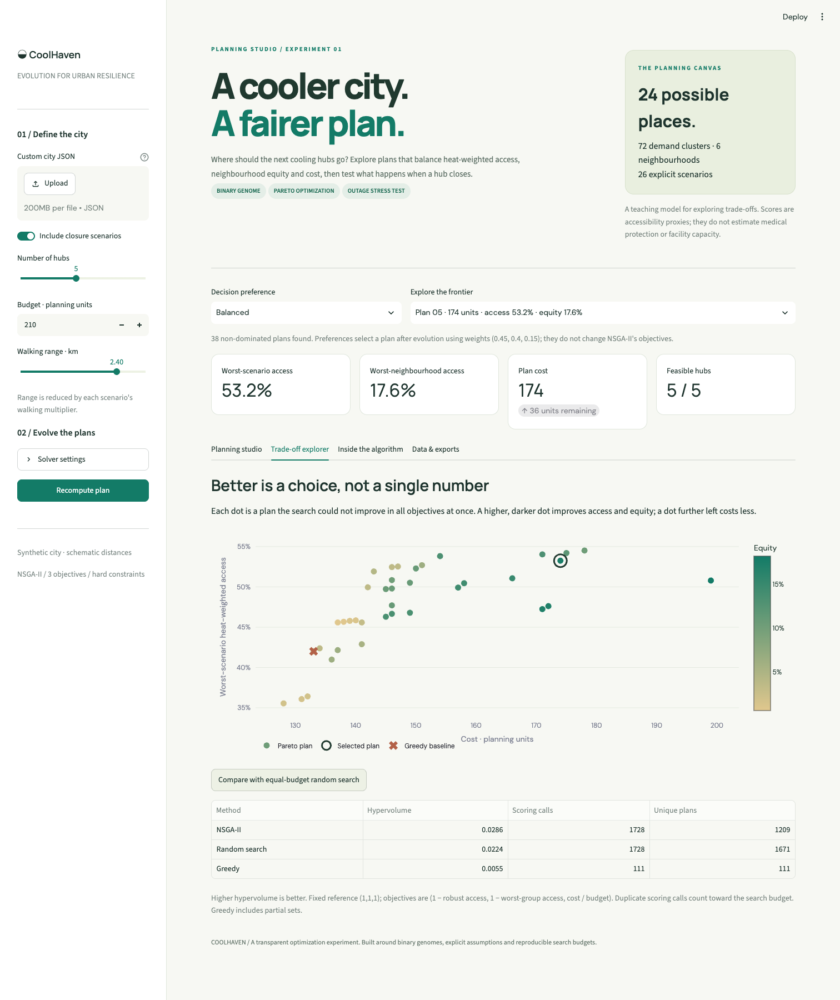

# ◒ CoolHaven

**A cooler city. A fairer plan.**

CoolHaven chooses where to open urban cooling hubs under a fixed hub count and budget. A binary genetic algorithm evolves a **Pareto frontier** balancing heat-weighted accessibility, access in the least-served neighbourhood, and operating cost. Each plan faces a heatwave and every possible single-hub closure.



[Hướng dẫn tiếng Việt](docs/PROJECT_VI.md) · [Mathematical model](docs/METHODOLOGY.md) · [Measured results](results/REPORT.md) · [Dataset schema](data/README.md)

## Why this project

A hub can look useful on a normal day and become a single point of failure during a closure. Maximizing total access can also leave one neighbourhood poorly served. CoolHaven makes those trade-offs visible instead of hiding them inside one fitness weight.

The project extends the binary encoding, tournament selection, uniform crossover, mutation and elitism introduced in **AIO2026 — Step-by-Step Genetic Algorithm**. Its contribution here is an integrated, reproducible planning experiment: from-scratch NSGA-II, hard budget repair, explicit outage stress tests and an interactive explanation of the resulting plans. It does not claim a new optimization algorithm or a world-first application.

## Run locally

Requires Python 3.11+ and [uv](https://docs.astral.sh/uv/).

```bash
git clone https://github.com/nleins5/coolhaven.git
cd coolhaven
uv sync --frozen --extra dev
uv run streamlit run app.py
```

Or use an ordinary virtual environment:

```bash
python -m venv .venv
source .venv/bin/activate  # Windows: .venv\Scripts\activate
python -m pip install -e ".[dev]"
streamlit run app.py
```

The `uv` path uses the committed dependency lock. The `pip` path resolves compatible versions. No API keys, map service or external dataset are required. The interface requests optional web fonts and falls back to system fonts when offline.

## Explore

- Adjust hub count, budget and walking range; enable or remove closure scenarios.
- Inspect demand clusters and active or closed hubs on a schematic map.
- Switch decision preferences or inspect any discovered Pareto plan.
- Compare the search against an equal-budget random baseline.
- Inspect binary chromosomes and archive hypervolume by generation.
- Upload your own city JSON and export the city, selected plan or frontier.

The dashboard uses a quick **48 × 35** configuration. The committed experiments use **64 × 60**; the two frontiers can differ.



## Reproduce the experiments

```bash
uv run coolhaven solve --data data/synthetic_city.json --out results
uv run coolhaven benchmark --data data/synthetic_city.json --out results
uv run python scripts/ablation.py
uv run python scripts/audit_exact.py
uv run pytest -q
uv run ruff check .
uv run ruff format --check .
```

Defaults: **24 candidate sites, 72 demand clusters, 6 neighbourhoods, 26 scenarios, 5 selected hubs, 210 cost units, 2.4 km walking range**. The benchmark uses seeds `11 23 42 71 97`, with **3,904 candidate scoring calls per seed** for both NSGA-II and random search. Duplicate calls consume that budget; unique counts are also reported.

| Method | Hypervolume, mean ± sample SD | Robust access¹ | Worst-group access¹ |
|---|---:|---:|---:|
| NSGA-II | 0.031266 ± 0.000172 | 53.027% | 15.318% |
| Random search | 0.026854 ± 0.000743 | 52.512% | 17.864% |
| Greedy | 0.005491 ± 0.000000 | 42.014% | 3.564% |

¹ Access columns describe one compromise selected with fixed weights `(0.45, 0.40, 0.15)`. Hypervolume measures the whole frontier, using reference `(1, 1, 1)` on normalized minimization objectives. NSGA-II's mean hypervolume is **16.4% higher** in this fixture; random search's chosen compromise has higher worst-group access. Greedy is deterministic and uses fewer scoring calls. This small experiment does not establish statistical significance or general superiority.

Raw runs, full input snapshots, configuration and environment metadata are committed under [`results/`](results/). Runtime measurements depend on hardware. The [ablation](results/ablation_metadata.json) separately compares planning with and without closure scenarios, then stress-scores the chosen plans using the same full evaluator.

The [exhaustive audit](results/exact_audit.json) checks all **42,504 combinations**, including **36,660 feasible plans**, and finds an exact frontier of 62 plans with hypervolume `0.031537`. The five NSGA-II runs achieve **99.14% of exact hypervolume on average**, with relative gaps from **0.15% to 1.57%**. This is a metric gap on this instance, not proof that the discovered frontier is complete.

## Code map

```text
app.py                       Streamlit planning studio
src/coolhaven/model.py        Data validation, constraints and accessibility
src/coolhaven/engine.py       NSGA-II, greedy, random and exact enumeration
src/coolhaven/pareto.py       Sorting, crowding and exact 3D hypervolume
src/coolhaven/cli.py          Reproducible command-line experiments
data/                        Synthetic fixture and input schema
tests/                       Numerical oracles, invariants, CLI and app tests
docs/                        Methodology and Vietnamese presentation guide
```

The solver uses NumPy, with no evolutionary optimization library. Tests check hypervolume against independent inclusion-exclusion calculations and compare a small genetic run with exhaustive enumeration. GitHub Actions runs lint, formatting and tests on Python 3.11–3.13.

## Scope

This is a **synthetic teaching prototype**. Distances are straight-line schematic kilometers. Costs, heat multipliers and vulnerability values are invented. Accessibility is a linear distance-decay score, not the percentage of residents medically protected. Neighbourhood labels are fictional, and hubs have no capacity constraints. A real deployment would need validated travel networks, facility capacities, local data and stakeholder review. See [assumptions and limitations](docs/METHODOLOGY.md#limitations).

## References

- Nguyen, A.-K., Vu, Y.-L., Duong, D.-T., & Dinh, Q.-V. *Step-by-Step Genetic Algorithm*. AI VIET NAM, All-in-One Course 2026. Course reading supplied for the project; the PDF is not redistributed.
- Deb, K., Pratap, A., Agarwal, S., & Meyarivan, T. (2002). [A fast and elitist multiobjective genetic algorithm: NSGA-II](https://doi.org/10.1109/4235.996017). *IEEE Transactions on Evolutionary Computation*, 6(2), 182–197.

[MIT License](LICENSE).
